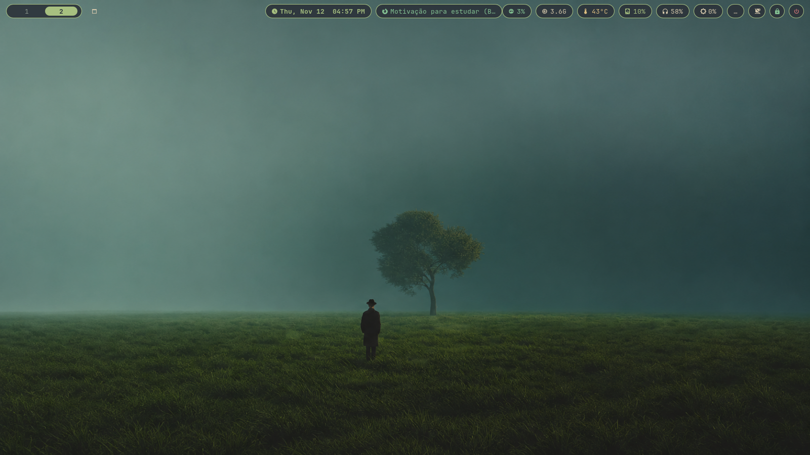
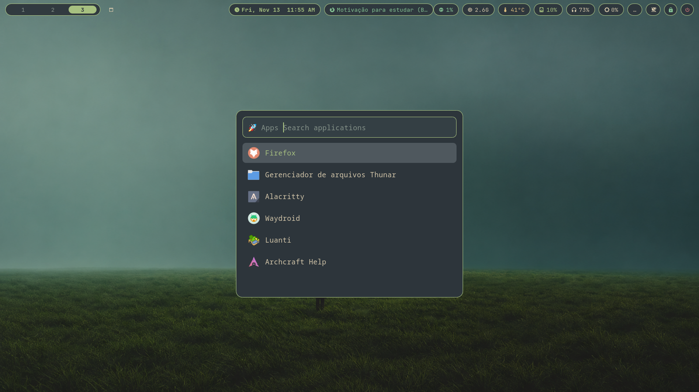

# Sway Dotfiles

Minimalist Wayland desktop configuration built around Sway.

## Screenshots

## Components

* **Window Manager:** Sway
* **Status Bar:** Waybar
* **Terminal:** Kitty
* **Prompt:** Starship
* **Launcher:** Rofi
* **Editor:** LunarVim (`Nvchat`)
* **Wallpaper:** Waypaper
* **Logout Menu:** Wlogout
